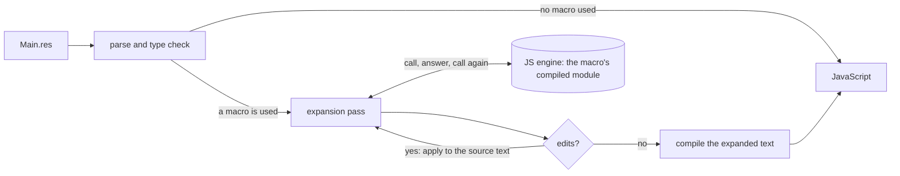

# RFC: compile-time macros

A macro is a ReScript function that the compiler runs while it compiles
another file. It returns code. It does the jobs a PPX does, and it can ask the
type checker about types, the way Zig's `comptime` can.

```rescript
// Debug.res
open Macro

@macro
let log = (e: code<'a>): code<'a> =>
  %code({
    let value = ${e}
    Console.log2(${Code.string(Code.print(e) ++ " =")}, value)
    value
  })
```

```rescript
// Main.res
let total = %Debug.log(price *. Int.toFloat(quantity))
// prints: price *. Int.toFloat(quantity) = 37.5
```

**Status.** Implemented in the Rust compiler (`compiler-rust/src/macros`),
with tests (`compiler-rust/tests/macros.rs`) and a browser playground
(`playground/`). `rescript build` does not expand macros yet; see
[What is missing](#what-is-missing). [IMPLEMENTATION.md](IMPLEMENTATION.md)
describes the compiler side.

- [Why](#why)
- [A tour](#a-tour)
- [Reference](#reference)
- [How it runs](#how-it-runs)
- [Cost](#cost)
- [Compared with](#compared-with)
- [What is missing](#what-is-missing)
- [Open questions](#open-questions)
- [Trying it](#trying-it)

## Why

ReScript code generation is done by PPXs today: native executables, written
in OCaml against a frozen copy of the parse tree, started once per file. They
see syntax only, so a JSON deriver cannot know what `user` is unless the type
is written out next to the attribute, and they cannot be written in ReScript.
The Rust compiler carries a port of one PPX (7,000 lines for ppx-spice)
because starting a process per file was too slow for it.

The first proposal for this directory copied Zig: mark a function `comptime`
and let the compiler partially evaluate its body. That works well when the
output is an expression built by walking a record. Every other shape of
output (a record literal, the arms of a switch, a new type, a module, a
derived name) needed a builtin of its own; the list reached 21 builtins, 3
attributes and 3 grammar forms, and the prototype needed a second evaluator
inside the type checker.

This design has one mechanism. A macro is an ordinary function: its loops
are loops and its helpers are functions. What it returns is written as
ReScript, and is type checked like code written by hand.

| | PPX | First proposal | This RFC |
| --- | --- | --- | --- |
| Written in | OCaml | ReScript | ReScript |
| Sees types | no | yes | yes |
| Output shapes | any syntax | expressions; a builtin per other shape | expressions, types, patterns, declarations |
| Special forms | none (attributes and extensions) | 27 | 7 |
| Runs in | a process per file | an evaluator in the type checker, plus a JS engine | a JS engine in the compiler |
| Macro body is type checked | by OCaml | no | yes |

## A tour

Every example here is a project in `playground/examples`, compiled by the
tests. On the web version of this page each one is live: edit the code and
the expansion, the JavaScript and the output follow.

### Quotes and holes

`%code(...)` is a quote: a piece of ReScript that is not evaluated, a value
of type `code<'a>`. `${...}` is a hole in it, filled with another piece of
code. `%type(...)` and `%pat(...)` quote a type and a pattern.

A quote is checked for syntax where it is written. Its types are checked
where the macro is used, after the holes are filled.

A hole stands for one thing. `${...items}` is a splice hole: it stands for
any number of items of a list. See [Lists in a quote](#lists-in-a-quote).

<!-- example: debug -->

```rescript
// Debug.res
@macro
let log = (e: code<'a>): code<'a> =>
  %code({
    let value = ${e}
    Console.log2(${Code.string(Code.print(e) ++ " =")}, value)
    value
  })

// Main.res
let total = %Debug.log(price *. Int.toFloat(quantity))
```

<!-- /example -->

### Code and values

A parameter of type `code<'a>` receives the code of the argument. A parameter
of an ordinary type receives a value, which the call site has to write as a
literal. There is no `comptime` keyword: the type of the parameter says when
it exists.

<!-- example: staged -->

```rescript
@generic
let rec pow = (base: code<float>, n: int): code<float> =>
  if n == 0 {
    %code(1.0)
  } else if mod(n, 2) == 0 {
    %code({
      let half = ${pow(base, n / 2)}
      half *. half
    })
  } else {
    %code(${base} *. ${pow(base, n - 1)})
  }
```

<!-- /example -->

`Power.pow(x, 10)` compiles to four multiplications. The recursion ran in the
compiler.

### Three ways to use a macro

| You write | The macro is | It receives | Its result |
| --- | --- | --- | --- |
| `%M.f(args)` | `@macro` | the code of each argument (`code<'a>` parameters) and the value of each literal (other parameters) | replaces the `%M.f(...)`: an expression, a type, a pattern, the contents of a module, or top-level declarations |
| `@M.f` on a `type` or a `let` | `@macro` | the checked type declaration (`Type.decl`), or the `let` before it is checked (`Decl.value`) | declarations: added after the type, or in place of the `let` |
| `M.f(args)` | `@generic` | the code of each argument, with its type | the body of a function the compiler makes for that type |

The first two are visible at the call site, like a PPX extension or
attribute. The third looks like a function call, and is for the functions
that would be generic if the language could express them: encoders,
comparisons, printers.

### Asking about types

`typeOf(value)` is the type of an argument of a `@generic`. `Type.info`
describes a type one level deep: its fields or constructors, with their types
as values that can be asked again.

<!-- example: json -->

```rescript
@generic
let encode = (value: code<'a>): code<JSON.t> =>
  switch Type.info(typeOf(value)) {
  | String => %code(JSON.Encode.string(${value}))
  | Int => %code(JSON.Encode.int(${value}))
  | Float => %code(JSON.Encode.float(${value}))
  | Bool => %code(JSON.Encode.bool(${value}))
  | Option(_) =>
    %code(
      switch ${value} {
      | Some(v) => encode(v)
      | None => JSON.Encode.null
      }
    )
  | Array(_) => %code(JSON.Encode.array(${value}->Array.map(v => encode(v))))
  | Record({fields}) =>
    let entries = fields->Array.map(f => {
      let key = f.attrs->Attr.string("Json.key")->Option.getOr(f.jsName)
      %code((${Code.string(key)}, encode(${value->Code.field(f.name)})))
    })
    %code(JSON.Encode.object(Dict.fromArray(${Code.array(entries)})))
  | Abstract({name}) =>
    switch Type.companion(typeOf(value), "toJson") {
    | Some(toJson) => %code(${toJson}(${value}))
    | None => error(`${name} is abstract and its module has no toJson`)
    }
  | _ => error(`Json.encode cannot encode the type ${Type.name(typeOf(value))}`)
  }
```

Used on a record:

```rescript
type user = {
  name: string,
  @Json.key("user_age") age: int,
  email: option<string>,
  tags: array<string>,
}

let json = Json.encode(alice)
```

The file the compiler compiles after expansion:

```rescript
let rec encode$user = (a$: user): JSON.t =>
  JSON.Encode.object(
    Dict.fromArray([
      ("name", encode$string(a$.name)),
      ("user_age", encode$int(a$.age)),
      ("email", encode$option_string(a$.email)),
      ("tags", encode$array_string(a$.tags)),
    ]),
  )
and encode$string = (a$: string): JSON.t => JSON.Encode.string(a$)
and encode$int = (a$: int): JSON.t => JSON.Encode.int(a$)
and encode$option_string = (a$: option<string>): JSON.t =>
  switch a$ {
  | Some(v) => encode$string(v)
  | None => JSON.Encode.null
  }
and encode$array_string = (a$: array<string>): JSON.t =>
  JSON.Encode.array(a$->Array.map(v => encode$string(v)))

let json = encode$user(alice)
```

<!-- /example -->

The macro does not recurse into the fields. It returns code that calls
`encode` on each field, and the compiler expands those calls in turn. That is
why a recursive type works, and why each type gets one function: an
*instance*.

A name with a `$` cannot be written in source, so an instance cannot collide
with a name of the file. The instances are not part of the module's signature
and are not exported. The backend inlines the small ones: the JavaScript of
`encode$user` reads `a$.name` directly.

A `@generic` waits for inference. It is expanded when the top-level item that
contains the call has been type checked, with the types inference settled on:

```rescript
let team = [alice, bob]
let all = team->Array.map(member => Json.encode(member))   // member: user
```

When the type is still unknown at that point, the error says so and asks for
an annotation.

A type the macro cannot see into is `Abstract`. `Type.companion(t, "toJson")`
is the value `toJson` in the module that defines the type, if there is one:
the way a library says "encode my type like this" without the macro knowing
the library.

### By the type that is expected

`expected()` is the type the call site of a `@generic` wants as result. A
decoder has nothing else to go on: its argument is always `JSON.t`.

<!-- example: decode -->

```rescript
@generic
let fromJson = (json: code<JSON.t>): code<'a> =>
  switch Type.info(expected()) {
  | String =>
    %code(
      switch ${json} {
      | String(text) => text
      | _ => fail("expected a string")
      }
    )
  | Option(inner) =>
    %code(
      switch ${json} {
      | Null => None
      | present => Some((fromJson(present): ${inner}))
      }
    )
  | Record({fields}) =>
    Code.record(
      fields->Array.map(f =>
        Code.entryOf(f, %code((fromJson(field(${json}, ${Code.string(f.jsName)})): ${f.typ})))
      ),
    )
  // ...
  }

// Main.res: the annotation is what the macro decodes to
let user: user = Decode.fromJson(json)
```

<!-- /example -->

`Code.entryOf(f, value)` is the field `f` of a record value. The next
sections are about it: [a record built from data](#a-record-built-from-data)
and [optional fields](#optional-fields).

The same idea gives a value for every type:

<!-- example: default -->

```rescript
let initial: settings = Default.value()
```

<!-- /example -->

### Two arguments

A `@generic` can take several pieces of code. Structural equality, written
out per type:

<!-- example: equal -->

```rescript
@generic
let equal = (a: code<'a>, b: code<'a>): code<bool> =>
  switch Type.info(typeOf(a)) {
  | Int | Float | String | Bool | Unit | BigInt | Char => %code(${a} === ${b})
  | Record({fields}) =>
    fields->Array.reduce(%code(true), (all, f) =>
      %code(${all} && equal(${a->Code.field(f.name)}, ${b->Code.field(f.name)}))
    )
  // ...
  }
```

<!-- /example -->

### A record built from data

A quote has the shape it is written with. A record whose fields are known
only when the macro runs is built from entries, one per field.
`Code.entry(name, value)` is `name: value` and `Code.spread(value)` is
`...value`. The values can have different types: the record is type checked
where the macro is used.

<!-- example: record -->

```rescript
// Convert.res: a record of the expected type, from the fields of another
@generic
let to = (value: code<'a>): code<'b> =>
  switch (Type.info(typeOf(value)), Type.info(expected())) {
  | (Record({fields: sources}), Record({fields: targets})) =>
    Code.record(
      targets->Array.filterMap(target => {
        let read = value->Code.field(target.name)
        switch sources->Array.find(source => source.name == target.name) {
        | Some({optional: false}) => Some(Code.entry(target.name, read))
        | Some(_) if target.optional => Some(Code.entry(target.name, read, ~optional=true))
        | None if target.optional => None
        // ... the other two are errors at the call
        }
      }),
    )
  | _ => error("Convert.to converts a record to a record")
  }

// Main.res
let shown: publicUser = Convert.to(ada)
```

<!-- /example -->

`~optional=true` writes `name: ?value`: the value is an option, and `None`
leaves the field out of the record.

### Lists in a quote

`${...items}` is a splice hole. It stands for any number of items of a list
in a quote, and the rest of the quote stays ordinary code. What it takes
follows from the list it is in:

| The list | The hole takes | |
| --- | --- | --- |
| Arguments of a call or a constructor, items of an array or a tuple | `array<code<'a>>` | `f(${...args})`, `[first, ${...rest}]` |
| Fields of a record | `array<Code.entry>` | `{id: 1, ${...fields}}` |
| Cases of a switch | `array<(pat, code<'a>)>` | `switch x { ${...cases} }` |

<!-- example: splice -->

```rescript
// Fields of a record, after fields the quote writes itself.
@generic
let withKey = (value: code<'a>, key: code<string>): code<'b> =>
  switch Type.info(typeOf(value)) {
  | Record({fields}) =>
    let rest = fields->Array.map(f => Code.entryOf(f, value->Code.field(f.name)))
    %code({key: ${key}, version: 1, ${...rest}})
  | _ => error("Splice.withKey needs a record")
  }

// Cases of a switch, before a case of the quote.
let cases = constructors->Array.map(c => (
  Pat.string(String.toLowerCase(c.name)),
  %code(Some(${Code.ident(c.name)})),
))
%code(
  switch String.toLowerCase(${text}) {
  ${...cases}
  | _ => None
  }
)
```

<!-- /example -->

A splice hole with no items leaves nothing behind, the comma after it
included. Items of different types go in one array as `Code.untyped(item)`.
A splice hole that is not in one of these lists is an error where it is
written.

### Declarations from a type

A macro attached to a type receives the declaration and returns
declarations, which are added after the type.

<!-- example: derive -->

```rescript
@macro
let derive = (t: Type.decl): decls =>
  switch Type.info(t.typ) {
  | Variant({constructors}) =>
    let label = (c: Type.constructor) => c.attrs->Attr.string("Enum.label")->Option.getOr(c.jsName)
    // One case per constructor: a pattern and the code of the case.
    let names = constructors->Array.map(c => {
      let (pattern, _) = Pat.constructor(c)
      (pattern, Code.string(label(c)))
    })
    %code(
      let ${Pat.var(t.name ++ "ToString")} = (value: ${t.typ}): string =>
        switch value {
        ${...names}
        }
      let ${Pat.var(t.name ++ "Values")}: array<${t.typ}> =
        [${...constructors->Array.map(c => Code.ident(c.name))}]
    )
  | _ => error("Enum.derive needs a variant type")
  }
```

```rescript
@Enum.derive
type color = Red | Green | @Enum.label("navy blue") Blue

colorValues->Array.map(colorToString)   // ["Red", "Green", "navy blue"]
```

<!-- /example -->

Names are built with `Pat.var`: a hole can stand where a name is bound.

One declaration per field, with the field's type in it:

<!-- example: lens -->

```rescript
@Lens.derive
type point = {x: int, y: int, label: string}

origin->Lens.update(point_x, x => x + 10)
```

<!-- /example -->

### Types

A macro in a type position takes types and returns a type.

<!-- example: types -->

```rescript
// Partial.res: every field optional
@macro
let t = (source: typ): typ =>
  switch Type.info(source) {
  | Record({fields}) => Type.record(fields->Array.map(Type.optional))
  | _ => error(`Partial.t needs a record type, and ${Type.name(source)} is not one`)
  }

// Main.res
type userPatch = %Partial.t(user)
```

<!-- /example -->

### Optional fields

The `typ` of a field is the type of `value.field`. For `nickname?: string`
that is `option<string>`, and `optional` is true. Everything that reads,
writes, binds or declares a field agrees with that type:

| | For `nickname?: string` |
| --- | --- |
| `value->Code.field(f.name)` | Code of type `option<string>`. |
| `Code.entryOf(f, value)` | `nickname: ?value`, for a value of type `option<string>`. `None` leaves the field out. |
| `Pat.constructor(c)` | Binds the field of an inline record as an `option<string>`. |
| `Type.record([f])` | Declares `nickname?: string`. |
| `Type.optional(f)`, `Type.required(f)` | `age?: int` from `age: int`, and back. The `typ` follows. |

A macro that treats every field the same is right for optional fields
without a special case. It looks at `f.optional` when it wants to do
something else for them.

<!-- example: optional -->

```rescript
// %Patch.t(user): every field optional
@macro
let t = (source: typ): typ =>
  switch Type.info(source) {
  | Record({fields}) => Type.record(fields->Array.map(Type.optional))
  | _ => error(`Patch.t needs a record type, and ${Type.name(source)} is not one`)
  }

// Patch.apply(value, patch): the fields of the patch that have a value
@generic
let apply = (value: code<'a>, patch: code<'p>): code<'a> =>
  switch Type.info(typeOf(value)) {
  | Record({fields}) =>
    Code.record(
      fields->Array.map(f => {
        let current = value->Code.field(f.name)
        let change = patch->Code.field(f.name)
        Code.entryOf(
          f,
          f.optional ? %code(Option.orElse(${change}, ${current})) : %code(Option.getOr(${change}, ${current})),
        )
      }),
    )
  | _ => error("Patch.apply needs a record")
  }
```

<!-- /example -->

A field that is made optional by hand, `{...f, optional: true}`, keeps a
`typ` that is not an option. `Type.record` reports that and names
`Type.optional`.

### Attributes on generated code

An attribute belongs to an expression, and generated code is an expression:
a quote writes the attribute in front of it. A field of a record value has
no place for an attribute, so it goes on the value of the field, or on the
whole record.

<!-- example: attrs -->

```rescript
// Mock.make(): a record of functions that fail when they are called. Their
// parameters are not used, and the user of the macro gets no warning for it.
| Function({params}) =>
  let named = params->Array.mapWithIndex((typ, i) => Code.param("arg" ++ Int.toString(i + 1), typ))
  let stub = Code.fn(named, %code(throw(Failure(${Code.string(f.name ++ " is not mocked")}))))
  Code.entryOf(f, %code(@warning("-27") ${stub}))

// An attribute the macro computes: `@warning("-27") value`
@macro
let allow = (warning: int, value: code<'a>): code<'a> =>
  Code.withAttr(value, "warning", ~payload=Code.string("-" ++ Int.toString(warning)))
```

<!-- /example -->

A hole cannot stand in an attribute: `Code.withAttr` is for a name or a
payload that is computed. The attributes of a field of a record type are
data, the `attrs` and the `jsName` of a `Type.field`.

### Patterns and checked literals

A macro that returns `pat` is used where a pattern is written. A macro that
takes a literal can check it and convert it while compiling: a color that is
not a color is not a program.

<!-- example: pattern -->

```rescript
let describe = code =>
  switch code {
  | %Http.status("ok") => "fine"
  | %Http.status("missing") => "not found"
  | _ => "other"
  }

let (red, green, blue) = %Http.color("#ff8800")
```

<!-- /example -->

### Modules and lets

A macro that returns declarations can fill a module, stand at the top level,
or replace the `let` it is attached to.

<!-- example: items -->

```rescript
module Length = %Units.table("meters", [("feet", 0.3048), ("miles", 1609.344)])

@Trace.calls
let marathon = (miles: float) => Length.milesToMeters(miles) /. 1000.0
```

<!-- /example -->

### Computing now

`%comptime(expr)` evaluates an expression while compiling and puts the value
in its place as a literal. It needs no macro: `expr` is ordinary code that
uses other modules.

<!-- example: comptime -->

```rescript
let primes = %comptime(Sieve.primesBelow(60))
```

```js
let primes = [2, 3, 5, 7, 11, 13, 17, 19, 23, 29, 31, 37, 41, 43, 47, 53, 59];
```

<!-- /example -->

The output does not import `Sieve`.

### Reading files

`Macro.readFile(path)` is the text of a file of the project. Here
`%I18n.t("title")` is a string, `%I18n.t("greeting")` is a function with a
labelled argument for each placeholder of the message, and a key that is not
in `en.json` does not compile.

<!-- example: files -->

```rescript
let title: string = %I18n.t("title")
let greet = %I18n.t("greeting")

greet(~name="Alice", ~count="3")
```

<!-- /example -->

```
  We've found a bug for you!
  Main.res:8:12-29

  7 │ // A key that is not in en.json does not compile:
  8 │ let oops = %I18n.t("goodbye")

  There is no message "goodbye" in en.json. It has: title, greeting, empty

  This is reported by the macro `I18n.t`.
```

### Errors

An error is reported in the code the person wrote, and says what the macro
has to do with it.

`Macro.error(message)` stops compilation with the message at the macro use,
as above. A macro that raises an exception is reported there too, as
"The macro `I18n.t` raised an exception".

An error in an argument points at the argument, because the argument is
still the text that was written:

```
  We've found a bug for you!
  Main.res:1:24-26

  1 │ let x = %Debug.log(1 + "a")

  This has type: string
  But it's expected to have type: int
```

Code a macro generates is type checked like written code. An error or a
warning in it is reported at the macro use, followed by the place in the
macro where that code is written:

```
  We've found a bug for you!
  Main.res:2:9-28

  1 │ let a = 1
  2 │ let x = %Quoted.twice(a + 1)

  This is in the code the macro generated, written at Quoted.res:7:9-13

  5 ┆ %code({
  6 ┆   let v = ${e}
  7 ┆   v + "two"
  8 ┆ })

  This has type: string
  But it's expected to have type: int
```

In a function generated for a `@generic`, the note says which one. Here a
field of `t` is a function, and the error is at the call that needed
`Json.encode` for `t`:

```
  We've found a bug for you!
  Main.res:2:21-31

  1 │ type t = {name: string, f: int => int}
  2 │ let enc = (t: t) => Json.encode(t)

  This is in the code generated by `Json.encode` for `t`, written at Json.res:25:35-40

  24 ┆   let key = f.attrs->Attr.string("Json.key")->Option.getOr(f.jsName)
  25 ┆   %code((${Code.string(key)}, encode(${value->Code.field(f.name)})))
  26 ┆ })

  Json.encode cannot encode the type int => int

  This is reported by the macro `Json.encode`.
```

Code that is not written in a quote (`Code.raw`, the builders) is shown as
it is in the expanded source. So is generated code that does not parse:

```
  Syntax error!
  Main.res:2:9-24

  1 │ let a = 1
  2 │ let x = %Throws.syntax()
  3 │ let b = 2

  This is in the code the macro generated. In the expanded source:

  1 │ let a = 1
  2 │ let x = (let = 1 +)
  3 │ let b = 2

  I'm not sure what to parse here when looking at "let".
```

## Reference

### The forms

| Form | Where | Meaning |
| --- | --- | --- |
| `@macro` | on a `let` | The function is a macro: used as `%M.f(...)` or attached as `@M.f`. |
| `@generic` | on a `let` | The function is a macro that is called like a function, with one instance per type. |
| `%code(...)` | expression | A quoted expression, or quoted declarations when the content is `let`, `type` or `module` items. |
| `%type(...)` | expression | A quoted type. |
| `%pat(...)` | expression | A quoted pattern. |
| `${...}` | inside a quote | A hole: an expression of type `code`, `typ` or `pat`, by its position. |
| `${...items}` | in a list of a quote | A splice hole: an array of the items of the list. The three dots are written. |
| `%comptime(expr)` | expression | The value of `expr`, computed while compiling. |

Everything else is the module `Macro` of the standard library
(`packages/@rescript/runtime/Macro.res`).

### Using a macro

A macro is named by a module path: `%Json.encode(x)`, `@Json.codec`,
`%Lib.Numbers.answer()`. An extension or attribute whose name starts with a
lowercase letter is not a macro, so existing PPX names and built-in
attributes keep their meaning.

| Position | Example | Macro type |
| --- | --- | --- |
| Expression | `%Debug.log(x + 1)` | `(...) => code<'a>` |
| Type | `type t = %Partial.t(user)` | `(typ, ...) => typ` |
| Pattern | `\| %Http.status("ok") => ...` | `(...) => pat` |
| Top level | `%%Gen.constants("k", 3)` | `(...) => decls` |
| Module | `module K = %Gen.constants("k", 3)` | `(...) => decls` |
| On a type | `@Enum.derive type color = ...` | `Type.decl => decls` |
| On a `let` | `@Trace.calls let f = ...` | `Decl.value => decls` |
| Call | `Json.encode(user)` | `@generic`: `(code<'a>, ...) => code<'b>` |

Arguments are separated by commas. An argument for a `code<'a>` parameter is
any expression. An argument for a parameter of another type is a compile-time
value: a number, a string, a boolean, `()`, or an array, tuple or record of
those.

A `@generic` is typed at the call as an ordinary function, with `code<t>`
read as `t`: `Json.encode` is an `'a => JSON.t`. It can be piped into and
passed as a value (`users->Array.map(Json.encode)`). A `@generic` with a
compile-time parameter has to be called directly.

### The `Macro` module

| | |
| --- | --- |
| `code<'a>`, `typ`, `pat`, `decls` | Code that evaluates to an `'a`; a type; a pattern; declarations. |
| `error(message)`, `errorAt(~offset, message)` | Stop compilation at the macro use. |
| `typeOf(code)` | The type of an argument of a `@generic`. |
| `expected()` | The type the call site of a `@generic` expects as result. |
| `readFile(path)`, `env(name)` | The text of a file, looked up from the directory of the file being compiled and then its parents; an environment variable of the build. |
| `Type.info(t)` | What the type is, one level deep (below). |
| `Type.name(t)` | The type as source text: `array<string>`. |
| `Type.companion(t, name)` | The value `name` in the module that defines `t`, as code. |
| `Type.record(fields)`, `Type.variant(constructors)`, `Type.field`, `Type.constructor` | Build a type. |
| `Type.option(t)` | `option<t>`. |
| `Type.optional(field)`, `Type.required(field)` | The field as `age?: int`, and as `age: int`. |
| `Code.string`, `int`, `float`, `bool`, `unit` | Literals. |
| `Code.ident(name)` | A name that is resolved where the macro is used. |
| `Code.field`, `array`, `tuple`, `record`, `call`, `switch_`, `fn` | Build code whose shape depends on data: a field access, a switch with one arm per constructor, a function with one parameter per name. |
| `Code.entry(name, value, ~optional=?)`, `Code.entryOf(field, value)`, `Code.spread(value)` | The entries `Code.record` and a splice hole in a record take: `name: value`, `name: ?value`, `...value`. |
| `Code.withAttr(value, name, ~payload=?)` | `@name(payload) value`. |
| `Code.untyped(code)` | The same code as `code<unknown>`, to put code of different types in one array. |
| `Code.print(code)` | The source text of a piece of code. |
| `Code.raw(text)` | Code from source text. Nothing checks it until the macro's result is compiled. |
| `Code.decls(items)` | Several declarations in a row. |
| `Pat.var(name)`, `Pat.any`, `Pat.string`, `Pat.int` | Patterns. |
| `Pat.constructor(c)` | The pattern that matches a constructor and binds its arguments, and the code of each bound argument with its type. |
| `Attr.find`, `has`, `string` | Look up an attribute of a field, constructor or declaration. |

`Type.info` returns one of:

```rescript
type info =
  | Int | Float | String | Bool | Unit | BigInt | Char
  | Option(typ) | Array(typ) | List(typ) | Dict(typ) | Promise(typ)
  | Result(typ, typ)
  | Tuple(array<typ>)
  | Record({name: string, fields: array<field>, attrs: array<Attr.t>})
  | Variant({name: string, constructors: array<constructor>, attrs: array<Attr.t>})
  | PolyVariant({constructors: array<constructor>})
  | Function({params: array<typ>, result: typ})
  | Abstract({name: string})   // hidden by an interface, or external
  | Unknown                    // inference has not settled it
```

A `field` has `name`, `jsName` (the `@as` name), `typ` (the type of
`value.name`: an option for an optional field), `optional`, `mutable_` and
`attrs`. A `constructor` has `name`, `jsName`, `args`,
`fields` (of an inline record) and `attrs`.

### Rules

- **A macro cannot be used in the file that defines it.** The compiler runs
  the compiled JavaScript of the macro's file, so that file is compiled
  first. A use of a macro is a dependency on its file.
- **A macro is deterministic.** It has no clock, no random numbers, no
  network and no file system of its own: `Math.random()`, `Date.now()` and
  `new Date()` raise. Its inputs are its arguments, the answers of the
  compiler (`Type.info`, `Type.companion`), `readFile` and `env`. That makes
  an expansion a function of inputs the build can record.
- **A macro has limits.** A call may take 20 seconds and its engine 512 MB;
  expansion of a file stops after 64 rounds. Each is an error at the macro
  use, not a hang.
- **Names in a quote.** A top-level name of the macro's own file that a
  quote mentions is resolved in that file: inside `Json.res`, `encode(v)` in
  a quote means `Json.encode(v)` wherever the macro is used. Every other
  name is resolved where the macro is used. A binder in a quote
  (`let value = ...`) is not renamed, so it can shadow a name the argument
  code uses; see [What is missing](#what-is-missing).
- **Instances.** An instance of a `@generic` is keyed by the macro, the
  types and values of its arguments and its result type. A file has one
  instance per key, in a `let rec` group before the first top-level item
  that needs it. Instances are not shared between files.
- **`%comptime`** can use other modules, not values of its own file. The
  value has to be writable as a literal: numbers, strings, booleans, `()`,
  arrays, tuples, options, dicts and records of those.

## How it runs



1. An ordinary compilation stops at the first macro use. A file without
   macros is compiled exactly as before, in one pass.
2. Expansion works on the source text. A pass type checks the file; at each
   macro use the type checker runs the macro and records the result as an
   edit of the text. The edits are applied and the next pass starts. A pass
   without edits ends it. Code a macro generated can use macros: they are
   expanded in the next pass.
3. The expanded text is compiled like any file. Every position is mapped
   back to the source as written, so errors, warnings and source maps point
   at the file the user edits; generated code has the position of the macro
   use it came from.
4. Macros run as JavaScript: the compiled output of the macro's module, in a
   JavaScript engine inside the compiler. Native builds embed QuickJS, one
   engine per compiler thread, created on first use. The playground uses the
   browser's engine.
5. The engine cannot call into the compiler. When a macro asks something
   (`Type.info`, `readFile`), the call ends with the question, the compiler
   answers it, and the macro runs again with the answer. A macro is
   deterministic, so the second run takes the same path.

Because expansion produces source text, the expanded file is something a
person can read, and a tool can show. The playground's "Expanded" tab is that
text.

## Cost

Measured on an Apple M-series Mac mini, release builds.

<!-- chart: cost -->

| What | Time |
| --- | --- |
| Create a QuickJS engine | 92 µs, once per compiler thread |
| Load a macro module | 84 µs, once per engine |
| Run a derive-style macro (10-field record, 41 questions to the compiler) | 14 µs |
| Start ppx-spice once (it is started once per file) | 6.1 ms |
| Start Node once | 70 ms |

<!-- /chart -->

The engine numbers are from a benchmark of the embedding with stub answers
(rquickjs 0.9); they do not include the type checker's work to answer.

The cost that matters is the passes. Each pass type checks the whole file
again, and a file needs one pass more than its deepest nesting of generated
code that uses macros: `Json.encode(user)` takes a pass for `user`, one for
the field types, one for what those contain. A file that uses no macro is
not affected: it takes the path it always took.

Not measured yet: a large project end to end. That needs the build system
integration.

## Compared with

| | Runs | Sees types | Output | Notes |
| --- | --- | --- | --- | --- |
| PPX (OCaml) | native process per file | no | parse tree | not writable in ReScript; frozen AST |
| Zig `comptime` | interpreter in the compiler | yes | the function body, partially evaluated | no quotes; the first proposal followed it |
| Rust procedural macros | native code per crate | no | token stream | derive sees syntax only |
| Template Haskell | interpreter in the compiler | yes (`reify`) | quotes and splices | the closest relative: typed quotes, staged by type |
| Scala 3 macros | the compiler's VM | yes | typed quotes | `inline` plus quotes; the staging idea here is the same |
| This RFC | JS engine in the compiler | yes | quotes of ReScript source | macro code is the module's ordinary JavaScript |

## What is missing

Implemented and tested: everything in the tour and the reference above. Not
implemented:

- **`rescript build`.** The build system compiles from parse trees it made
  earlier and does not call expansion. It needs: macro names in the
  dependency scan, a host that reads the compiled JavaScript of a module,
  and expansion when a compilation asks for it. The compiler side is one
  call (`driver::compile_source_in_process` does it for the tests and the
  playground).
- **A cache.** An expansion is a function of the macro's code, its
  arguments, the answers it got and the files it read. Storing results in
  the build database (`lib/bs/rescript.sqlite`) keyed on those makes
  rebuilds skip the engine.
- **Hygiene for binders.** A `let` inside a quote can capture a name used by
  argument code. The plan is a fresh mark per expansion on binders that a
  quote introduces, with `Code.ident` as the explicit way out.
- **A quote is checked where it is used.** An error in generated code names
  the place in the quote, but only once a use expands it: a macro whose
  quote cannot have the type the macro declares compiles until then.
- **Splice holes in patterns and types.** `${...items}` stands in lists of
  expressions. The fields of a record type are built with `Type.record`,
  and the arguments of a constructor pattern with `Pat.constructor`.
- **Attribute payloads beyond one string.** `@Json.key("user_age")` reaches
  the macro; `@Json.codec({strict: true})` does not yet pass its argument.
- **Parametric types.** `Type.info` of `result<a, b>` or a record with type
  parameters works for the common shapes, without a specification of what
  it returns for the rest.
- **Types local to an expression** cannot be named by an instance, which
  lives at the top level.
- **Sharing instances between files.** Two files that encode `user` each
  get an `encode$user`.
- **Editor tooling**: hover and go-to-definition inside macro uses, and a
  command to show the expansion.
- **Interface files.** A macro module with a `.resi` is untested: the
  interface has to carry `@macro` and `@generic`.
- **Windows and the playground of rescript-lang.org.** QuickJS is C; it
  builds on macOS and Linux here and is untested on the other release
  targets.

## Open questions

1. **Explicit quotes or Zig-style bodies.** This RFC chooses quotes: one
   mechanism for every output shape, at the cost of a quote mark on each
   generated piece.
2. **The plain-call form.** `Json.encode(user)` hides that a macro runs.
   The alternative is `%Json.encode(user)` everywhere, which is honest and
   noisier, and cannot be passed as a value.
3. **The engine.** QuickJS only, or Node as an option for macros that need
   npm packages with native parts. QuickJS runs plain JavaScript packages.
4. **Names.** `@macro`, `@generic`, `%code`, `%comptime`, the module
   `Macro`. `Macro.Type` takes the place of the standard library's `Type`
   under `open Macro`; it includes that module so nothing is lost.
5. **Text or trees.** Expansion edits source text and type checks again.
   It is simple, and gives generated code everything written code gets. A
   tree-based expansion that types only the generated piece is faster and
   much more code. The measurement that decides is a large project with
   many derives.

## Trying it

```bash
# the tests
cargo test --manifest-path compiler-rust/Cargo.toml --test macros

# the playground
cd playground
npm ci
npm run build:wasm
npm run dev
```

The playground's main page is this document with the examples live; the
full playground, with any number of files, is `playground.html`.
